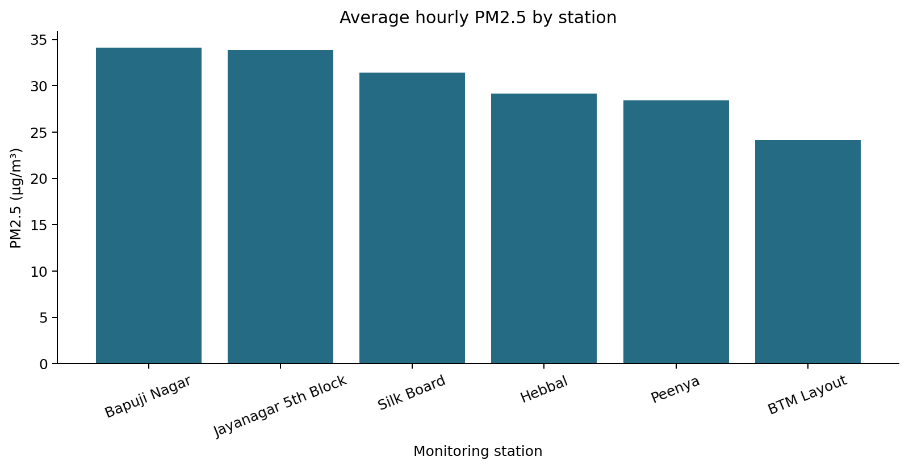
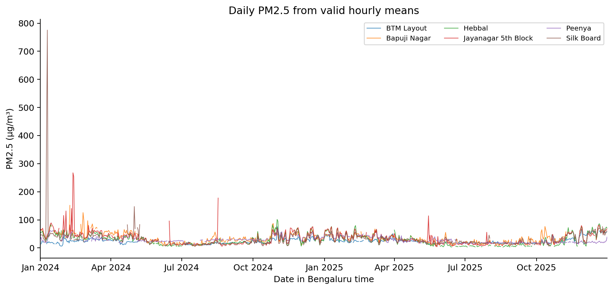
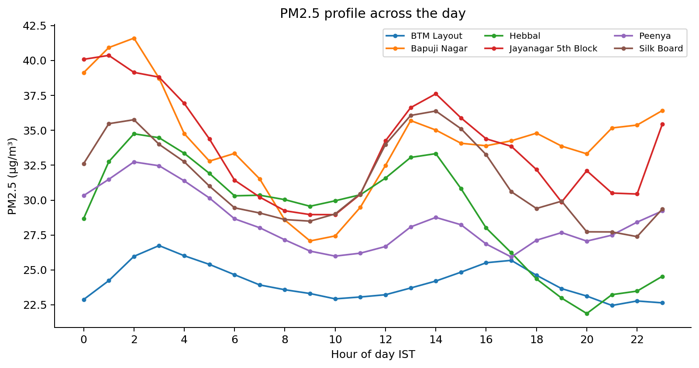
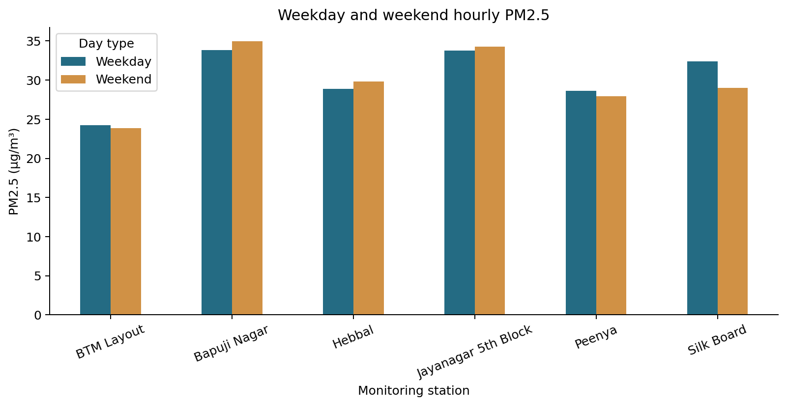
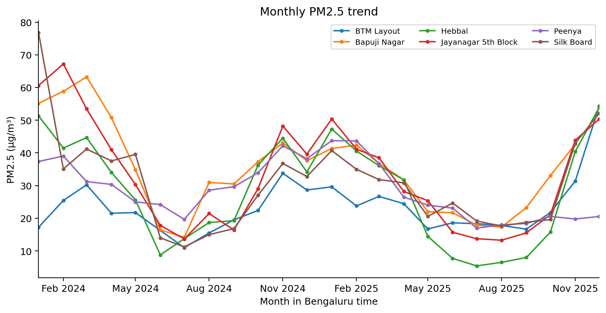
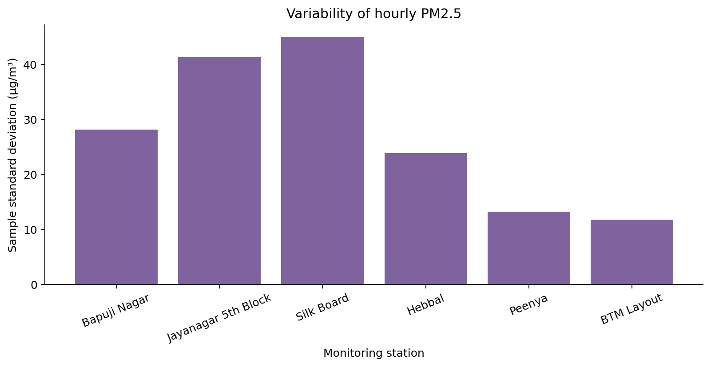
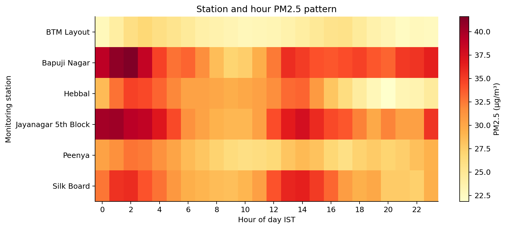
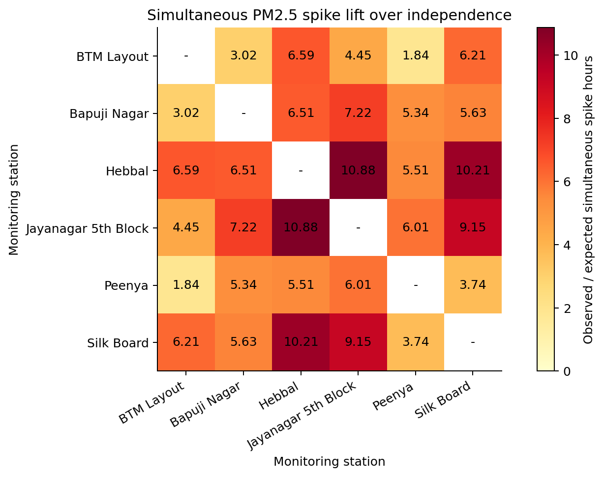

Station patterns and synchronized PM2.5 spikes using Apache Spark

Ramaiah Institute of Technology
Department of Computer Science and Engineering
Big Data Analytics
Subject code CSE557
Academic term 2026

Historical observations from six Bengaluru monitoring stations
Study window 1 January 2024 to 31 December 2025 in IST

Student name | USN
--- | ---
Anusha Agarwal | 1MS24CS034
Jeevika N | 1MS24CS071

Faculty guide: Uzma Sulthana

Analysis executed on 2026-10-31. All reported project measurements come from the saved execution outputs.

## Report contents

1  Real world scenario and problem statement

2  Recent research paper and existing approach

3  Objectives and proposed analysis

4  Dataset identification and preparation

5  Big Data implementation and workflow

6  Results visualization and paper comparison

7  Performance evaluation and observations

8  Tools responsible use and references

The eight main sections follow the faculty assignment. Subsections include the abstract, research review, implementation, empirical results, performance, limitations and execution appendix.

### Abstract

This project analyzes 398,420 source rows from six Bengaluru air-quality CSV files. After cleaning and hourly coverage checks, 92,479 station-hour PM2.5 observations remain. Bapuji Nagar has the highest observed mean at 34.14 µg/m³, compared with 24.12 µg/m³ at BTM Layout. Station-specific 95th-percentile thresholds identify unusually high hours. Of 7,990 hours observed at all six stations, 461 contain spikes at two or more stations. Pairwise coincidence is compared with a marginal-probability independence baseline. Eight charts and the analytical tables are generated using real data. Independent pandas recomputation verifies the Spark outputs. These are descriptive historical findings; they establish neither pollutant transport nor prediction performance.

## 1 Real world scenario and problem statement

### Introduction

A citywide average can hide differences between monitoring locations. Bengaluru AirWatch examines how measured PM2.5 varies between stations, across hours and across months, and whether unusually high readings coincide. It uses historical monitoring data rather than live streaming. The analysis supports comparison and investigation, rather than issuing health advisories or identifying emission sources.

### Real world scenario and problem statement

The central question is whether station-relative PM2.5 spikes occur together across Bengaluru or remain specific to individual locations. The practical difficulty is aligning heterogeneous coverage without turning missing values into clean-air observations. A reproducible DataFrame workflow is useful for ingestion, quality auditing, aggregation and timestamp joins. This local dataset demonstrates these operations but does not require a distributed cluster.

### Stakeholders and analytical questions

Stakeholder | Question supported by this analysis
--- | ---
Pollution monitoring staff | Which stations have higher observed levels and fluctuations?
City researchers | Which hours and months show higher concentrations?
Students and project reviewers | Can counts, thresholds and comparisons be reproduced from source files?
Urban planning analysts | Which station pairs show coincident high readings that merit further investigation?

## 2 Recent research paper and existing approach

### Research paper review

Soni and colleagues published Temporal dynamics of urban air pollutants and their correlation with associated meteorological parameters: an investigation in northern Indian cities in Environmental Monitoring and Assessment, volume 196, article 505, on 3 May 2024 [1]. It investigates six pollutants at ten northern Indian monitoring locations and their meteorological associations. The publisher abstract reports spatial differences and positive PM2.5–NO2 associations [2].

The author-supplied text describes CPCB observations, temporal summaries, bivariate polar plots, HYSPLIT trajectories and analysis in R 4.2.0 [4]. Its period descriptions differ: the overview and figures extend from January 2017 to March 2021, while parts of the methodology refer to March or December 2020. This discrepancy is retained rather than resolved by assumption.

### Existing approach and limitations

The reviewed work connects concentrations with meteorology and transport indicators. It does not supply the present project’s Spark pipeline or station-pair spike baseline. Its northern locations and earlier period limit direct transfer to Bengaluru. Reported data gaps and inconsistent period descriptions also warrant caution. Our comparison therefore concerns analytical scope and workflow; it is not a numerical replication or a causal source-attribution study.

## 3 Objectives and proposed analysis

### Project objectives

- Prepare six source files and account for every input row, missing PM2.5 value, duplicate and rejected hourly bucket; preserve immutable raw data and publish file checksums.
- Implement and execute Spark DataFrame and SQL analyses producing station summaries, five temporal tables, 95th-percentile spike detection and all 15 station-pair synchronization comparisons.
- Evaluate the analysis using independent pandas recomputation, eight meaningful visualizations, measured execution times and a three-repeat warm aggregation comparison on the same hourly data.
### Proposed methodology

Parse source timestamps with their encoded +0000 offset and express calendar calculations in Asia/Kolkata. Restrict observations to the local 2024–2025 window. Reject absent station identifiers, invalid timestamps, missing or nonnumeric PM2.5, negative or nonfinite concentrations and timestamps outside the quarter-hour grid. Keep zero if measured. Collapse identical selected observations and average conflicting values at the same station and instant. Compute hourly means only when at least three distinct quarter-hour observations remain.

For each station, compute the exact interpolated 95th percentile of its valid hourly means. An hour is a spike only when its mean is strictly greater than that threshold. Ties can make the spike rate differ from 5%. Thresholds describe relative extremes, not regulatory exceedances. They are estimated on the analyzed period and are not evaluated as an out-of-sample detector.

For a pair with N overlapping valid hours, let A and B be its individual spike counts on those same hours and J the simultaneous spike count. The independence expectation is A × B / N; lift is J divided by that expectation. Jaccard overlap is J / (A + B − J). These descriptive baselines do not remove seasonality or serial dependence and are not significance tests. A second table uses only hours observed at all six stations to summarize citywide coincidence.

## 4 Dataset identification and preparation

### Dataset identification and description

The source is the OpenCity Bengaluru Hourly Air Quality Reports catalog [5], under its KSPCB organization. Six selected resources are labelled 15-minute AQI Data for 2024–25, including two CPCB-labelled stations. Their actual schema contains concentrations and weather variables, with no AQI column. PM2.5 is measured in µg/m³ and is the sole analysis variable. CO uses mg/m³ and NOx uses ppb; they are not mixed with PM2.5. Total source size is 68,534,283 bytes (65.36 MiB). All six schemas contain 29 matching columns.

Station | Source rows | MiB | Start UTC | End UTC
--- | --- | --- | --- | ---
Bapuji Nagar | 64,195 | 10.31 | 2024-01-01 | 2025-11-09
BTM Layout | 63,845 | 12.10 | 2024-01-01 | 2025-12-31
Hebbal | 67,961 | 9.54 | 2024-01-01 | 2025-12-31
Jayanagar 5th Block | 66,786 | 11.21 | 2024-01-01 | 2025-12-31
Peenya | 65,456 | 11.10 | 2024-01-01 | 2025-12-31
Silk Board | 70,177 | 11.10 | 2024-01-01 | 2025-12-31

Timestamps explicitly encode UTC. The project honors that encoding and converts to IST; the original instrument timezone convention has not been independently confirmed with the publisher. The 2026 local-time spillover caused by conversion is excluded. Resource filenames and exact URLs, byte sizes, SHA-256 checksums and first and last raw records are preserved in data/manifest.json. Catalog metadata is preserved in data/catalog_snapshot.json.

### Dataset preprocessing

Processing stage | Rows or buckets
--- | ---
Source CSV rows | 398,420
Rejected source rows | 28,097
Valid source observations | 370,323
After identical selected observations collapse | 370,323
Unique station and timestamp observations | 370,323
Candidate station-hour buckets | 95,708
Hours rejected for fewer than three quarters | 3,229
Retained station-hour means | 92,479

- missing_or_invalid_pm25: 27,983 source rows.
- missing_station: 6 source rows.
- outside_study_window: 108 source rows.
- valid: 370,323 source rows.
The files contain six single-field year separator rows. They have missing station and timestamp fields and are included in the rejection audit. Identical selected observations removed: 0; additional conflicting station-timestamp values combined: 0. No missing measurement is imputed. Valid high concentrations are retained because no verified sensor-specific upper bound is available. This can leave instrument outliers in the maxima and percentile estimates. Quality counts refer to PM2.5 processing; other variables remain unchanged in raw files.

### Big Data characteristics

Characteristic | Evidence and interpretation
--- | ---
Volume | 398,420 rows and 65.36 MiB across six files; manageable locally, not evidence of very large scale.
Velocity | Source resources are labelled 15-minute observations; the submitted workflow is historical batch processing.
Variety | Station metadata, offset-aware timestamps, pollutant concentrations and meteorological fields; matching CSV schemas in the selected subset.
Veracity | Missing measurements, separator rows, incomplete station coverage, repeated readings and uncertain sensor validation require explicit audits.

## 5 Big Data implementation and workflow

### System architecture and workflow

OpenCity catalog and six pinned CSV URLs → checksum-verified raw files

Spark CSV reader → selected columns → typed timestamps and PM2.5 → rejection audit

Duplicate resolution → hourly coverage filter → cached hourly DataFrame

Spark aggregations and SQL → percentile thresholds → timestamp joins → analytical tables

Matplotlib charts → independent pandas validation → report and handoff

### Implementation details

File | Responsibility
--- | ---
src/data_ingestion.py | Download and verify manifest files; inspect all schemas and column completeness; load Spark CSVs.
src/preprocessing.py | Typed parsing, study-window and quality rules, duplicate handling and hourly coverage.
src/analysis.py | Station statistics and five temporal SQL queries.
src/spike_detection.py | Exact percentile and strict spike indicators.
src/synchronization.py | Pairwise overlap, independence expectation, lift, Jaccard and complete-case counts.
src/visualization.py | Eight charts from exported tables.
src/verification.py | Independent real-data recomputation and assertions.
main.py | Execution, timed actions, output exports and validation.
build_report.py | Generate this report and the group handoff from saved results.

The implementation uses spark.read.csv, select, withColumn, try_cast, filter, dropDuplicates, groupBy, agg and join. SQL extracts local hours, weekdays and months. Caching materializes cleaned hourly data for repeated analyses. Every timed Spark transformation ends in an action such as count or collect, so the reported times include actual computation rather than lazy plan construction. Raw data is retained. Only the smaller processed and aggregate outputs are collected to the driver; this export design is suitable for the local dataset and would need revision for much larger outputs.

## 6 Results visualization and paper comparison

### Results and visualizations

Station | Hours | Mean | Median | Min | Max | SD
--- | --- | --- | --- | --- | --- | ---
Bapuji Nagar | 15,143 | 34.14 | 30.00 | 1.00 | 794.00 | 28.16
Jayanagar 5th Block | 15,789 | 33.90 | 27.25 | 1.00 | 834.00 | 41.30
Silk Board | 15,456 | 31.41 | 26.00 | 1.00 | 873.00 | 44.92
Hebbal | 15,717 | 29.16 | 24.25 | 1.00 | 625.50 | 23.91
Peenya | 15,308 | 28.45 | 26.12 | 0.43 | 144.81 | 13.23
BTM Layout | 15,066 | 24.12 | 20.51 | 0.27 | 152.96 | 11.79

All concentration summaries in the table are in µg/m³ and describe hourly means. SD is the sample standard deviation. Statistics use each station’s own available observations; they are not population exposure estimates or rankings of all Bengaluru neighborhoods.

### Figure 1 Station average

Bapuji Nagar records the highest observed station mean at 34.14 µg/m³; BTM Layout records the lowest at 24.12 µg/m³. Unequal missingness and station coverage can affect this ordering. On the all-six common hours, the highest mean is Bapuji Nagar at 36.55 µg/m³.

Source: generated Spark analytical tables from the six OpenCity station CSV files. Figure generated by src/visualization.py.

### Figure 2 Pollution over time

The time series displays daily means only when at least 18 valid hourly means exist; unobserved days remain gaps. The largest displayed station-day mean is 775.53 µg/m³ at Silk Board on 2024-01-10. Individual peaks should be checked against instrument records before attributing a local cause.

Source: generated Spark analytical tables from the six OpenCity station CSV files. Figure generated by src/visualization.py.

### Figure 3 Hour wise pattern

The largest station-specific average hour profile is 41.60 µg/m³ at Bapuji Nagar in the 02:00 IST hour. It averages available days and does not imply that every day peaks at this time.

Source: generated Spark analytical tables from the six OpenCity station CSV files. Figure generated by src/visualization.py.

### Figure 4 Weekday and weekend comparison

Weekend minus weekday mean differences range from -3.38 to 1.17 µg/m³ across stations. The comparison is descriptive and unadjusted for season, weather, holidays or missing data; it does not identify a traffic effect.

Source: generated Spark analytical tables from the six OpenCity station CSV files. Figure generated by src/visualization.py.

### Figure 5 Monthly trend

The highest station-month mean is 76.84 µg/m³ at Silk Board in 2024-01, based on 738 valid hours. Month-to-month variation is visible, but the figure does not separate emissions from meteorology.

Source: generated Spark analytical tables from the six OpenCity station CSV files. Figure generated by src/visualization.py.

### Figure 6 Station variability

Silk Board has the largest sample standard deviation at 44.92 µg/m³. The IQR and coefficient of variation are also saved in station_statistics.csv so that absolute dispersion is not the only available comparison.

Source: generated Spark analytical tables from the six OpenCity station CSV files. Figure generated by src/visualization.py.

### Figure 7 Station hourly heatmap

The heatmap summarizes station-specific hourly patterns using the same means as the hour-profile chart. A common color scale supports comparison across stations. Missing source hours are excluded rather than colored as zero.

Source: generated Spark analytical tables from the six OpenCity station CSV files. Figure generated by src/visualization.py.

### Figure 8 Spike synchronization heatmap

The strongest pair by lift is Hebbal and Jayanagar 5th Block: 409 observed simultaneous spike hours versus 37.61 under marginal independence, a lift of 10.88. The diagonal is omitted because it would compare a station with itself.

Source: generated Spark analytical tables from the six OpenCity station CSV files. Figure generated by src/visualization.py.

### Cross Station Synchronization Analysis

Station | Threshold µg/m³ | Spike hours | Valid hours
--- | --- | --- | ---
BTM Layout | 50.67 | 754 | 15,066
Bapuji Nagar | 69.22 | 758 | 15,143
Hebbal | 71.30 | 786 | 15,717
Jayanagar 5th Block | 72.25 | 784 | 15,789
Peenya | 53.16 | 766 | 15,308
Silk Board | 62.75 | 761 | 15,456

There are 7,990 hours with valid observations at all six stations. Among these, 461 hours (5.77%) have at least two simultaneous station-relative spikes; 810 have exactly one. Among complete-case hours with any spike, the multiple-station share is 36.27%. An isolated flag refers to the monitored stations only and cannot establish that a pollution event is geographically isolated.

Station pair | Overlap h | Both spike h | Expected h | Lift
--- | --- | --- | --- | ---
Hebbal / Jayanagar 5th Block | 14,262 | 409 | 37.61 | 10.88
Hebbal / Silk Board | 13,883 | 376 | 36.82 | 10.21
Jayanagar 5th Block / Silk Board | 13,964 | 355 | 38.79 | 9.15
Bapuji Nagar / Jayanagar 5th Block | 13,642 | 223 | 30.90 | 7.22
BTM Layout / Hebbal | 13,553 | 275 | 41.71 | 6.59
Bapuji Nagar / Hebbal | 13,451 | 170 | 26.11 | 6.51
BTM Layout / Silk Board | 13,247 | 241 | 38.79 | 6.21
Jayanagar 5th Block / Peenya | 13,717 | 220 | 36.59 | 6.01
Bapuji Nagar / Silk Board | 13,219 | 145 | 25.77 | 5.63
Hebbal / Peenya | 13,697 | 183 | 33.23 | 5.51
Bapuji Nagar / Peenya | 13,122 | 172 | 32.23 | 5.34
BTM Layout / Jayanagar 5th Block | 13,670 | 181 | 40.70 | 4.45
Peenya / Silk Board | 13,427 | 129 | 34.53 | 3.74
BTM Layout / Bapuji Nagar | 12,984 | 26 | 8.60 | 3.02
BTM Layout / Peenya | 13,169 | 76 | 41.30 | 1.84

Pairwise overlap differs by pair. Thresholds are estimated from each station’s full valid study-window hours; the independence expectation uses spike marginals recomputed within each pair’s actual overlap. Positive lift may reflect common seasonal patterns or time dependence. No p-value, atmospheric trajectory or direction of movement is estimated.

### Research Paper Comparison

Dimension | Selected paper | Bengaluru AirWatch
--- | --- | ---
Location | Ten northern Indian monitoring locations | Six stations within Bengaluru
Variables | Six pollutants and meteorological variables | Hourly PM2.5 concentration
Processing | R-based statistical and atmospheric analysis | Spark DataFrames and Spark SQL
Question | Temporal patterns and meteorological associations | Station patterns and simultaneous relative spikes
Transport evidence | Trajectory and directional analyses described | No transport model or source attribution
Comparison boundary | Earlier period and different geography | Method-level comparison; numerical replication is not claimed

The shared emphasis is temporal and spatial concentration variation. Our contribution is an auditable timestamp-aligned coincidence analysis with an explicit overlap denominator. The paper is used as an environmental analysis reference; it is not evidence that this local execution demonstrates Big Data scalability.

## 7 Performance evaluation and observations

### Performance Evaluation

Measure | Observed result
--- | ---
Input size | 68,534,283 bytes
Input source rows | 398,420
Output station-hours | 92,479
Spark startup | 22.372 s
CSV ingestion and cleaning actions | 31.316 s
Analytical aggregations and table materialization | 19.157 s
Processed CSV export | 4.634 s
Chart generation | 4.987 s
Independent verification | 12.491 s
Total local run excluding downloads | 126.294 s
Warm Spark grouped statistics median | 0.4934 s
Warm pandas grouped statistics median | 0.0306 s

The benchmark runs count, mean, minimum, maximum and sample standard deviation by station on the same hourly data. Both engines are warmed once and measured three times. Spark reads its cached hourly DataFrame; pandas uses an in-memory DataFrame exported from it. Parsing, cleaning, median calculation and startup are excluded from both benchmark timers. The three raw repetitions are saved. These timings describe this machine and workload only and do not compare complete end-to-end pipelines.

Pandas is faster for this small warm grouped aggregation in the measured local run. Spark scheduling and JVM coordination add overhead at this scale; no Spark speed advantage or cluster scalability is claimed.

Test setup | Configuration
--- | ---
Operating system | Windows-11-10.0.26300-SP0
Processor | AMD Ryzen 5 3500U with Radeon Vega Mobile Gfx
Logical CPU count | 8
Physical RAM | 13.92 GiB
Python | 3.12.14 (main, Aug 25 2026, 14:01:42) [MSC v.1944 64 bit (AMD64)]
PySpark | 4.0.1
Java | openjdk version "21.0.11" 2026-04-21 LTS
Master | local[2]
Shuffle partitions | 4
Adaptive query execution | Enabled
Session time zone | Asia/Kolkata

### Observations and Discussion

The independent verification status is PASS. Checks compare every retained hourly row, station statistics, all exact thresholds, all spike counts, all pairwise overlaps and all temporal means and sample counts with pandas. Complete-case coincidence counts also agree. The common-hour station table helps assess the sensitivity of station rankings to missingness. The dataset supports evidence of coincident and single-station relative extremes, but does not explain their physical causes.

### Limitations

- Only six selected monitoring locations are included, so the findings do not represent all Bengaluru neighborhoods or personal exposure.
- Coverage and missingness differ between stations. Complete-case restriction improves alignment but can itself select a nonrepresentative subset.
- The 15-minute source label does not guarantee independent instrument measurements; repeated concentrations can reflect source reporting or sensor averaging.
- Timestamp offsets are honored as encoded; an upstream timezone-labeling error would shift the hour-of-day interpretation.
- No sensor calibration or independent validation is available. Extreme valid measurements are retained and may influence statistics.
- Percentile thresholds are fitted on the analyzed period. The method is retrospective and does not evaluate forecasting or alarm accuracy.
- The independence baseline does not control for seasonality, meteorology or serial correlation. Lift is not a causal or inferential result.
- Local execution and driver-side exports do not establish cluster performance. The measured workload is small enough for pandas.
### Future Improvements

Confirm timestamp conventions and instrument quality flags with the publisher; expand station coverage; evaluate matched-season comparisons; use season-preserving shift or block-resampling baselines; and evaluate threshold stability on a held-out period. If substantially larger sources become available, write distributed Parquet outputs and measure multiple cluster sizes on the same workload.

### Conclusion

The project executes a reproducible PM2.5 analysis over 398,420 source rows and retains 92,479 valid station-hours. It produces eight charts, station and temporal summaries, all station-pair spike comparisons and measured execution evidence. The results show station differences and a mixture of single-station and synchronized high hours. They provide a basis for further investigation, with missingness, relative-threshold and local-performance limitations explicitly retained.

## 8 Tools responsible use and references

### Tools and responsible use

Python, Apache Spark through PySpark, Spark SQL, pandas, NumPy and Matplotlib support execution and verification. python-docx produces the editable report; the rendering workflow exports its PDF. The original raw files remain unchanged and are excluded from Git. OpenCity catalog metadata labels the selected dataset Other (Public Domain); attribution to KSPCB, CPCB-labelled stations and OpenCity is retained. A manifest and downloader are provided instead of redistributing raw files in GitHub. The data are environmental station measurements, not individual personal records. Credentials are never committed. AI assisted code and report preparation; numerical findings are generated and verified by executable code.

### References

[1] Soni et al. 2024. Temporal dynamics of urban air pollutants and their correlation with associated meteorological parameters: an investigation in northern Indian cities. Environmental Monitoring and Assessment 196, article 505. Access checked 31 October 2026.

[https://doi.org/10.1007/s10661-024-12678-z](https://doi.org/10.1007/s10661-024-12678-z)

[2] Publisher record. Verified title, publication date and abstract. Access checked 31 October 2026.

[https://link.springer.com/article/10.1007/s10661-024-12678-z](https://link.springer.com/article/10.1007/s10661-024-12678-z)

[3] PubMed. Bibliographic and abstract fallback, PMID 38700603. Access checked 31 October 2026.

[https://pubmed.ncbi.nlm.nih.gov/38700603/](https://pubmed.ncbi.nlm.nih.gov/38700603/)

[4] Author supplied full text. Methodology, R version, study period inconsistencies and limitations. The author-hosted page restricts some automated access; publisher and PubMed links provide bibliographic fallbacks. Access checked 31 October 2026.

[Author supplied full text on ResearchGate](https://www.researchgate.net/publication/380321341_Temporal_dynamics_of_urban_air_pollutants_and_their_correlation_with_associated_meteorological_parameters_an_investigation_in_northern_Indian_cities)

[5] OpenCity and KSPCB. Bengaluru Hourly Air Quality Reports. Selected 2024-2025 station resources; see data/manifest.json for exact downloads. Access checked 31 October 2026.

[https://data.opencity.in/dataset/bengaluru-hourly-air-quality-reports](https://data.opencity.in/dataset/bengaluru-hourly-air-quality-reports)

[6] Apache Spark 4.0.1. Installation, Java and Python requirements. Access checked 31 October 2026.

[https://spark.apache.org/docs/4.0.1/api/python/getting_started/install.html](https://spark.apache.org/docs/4.0.1/api/python/getting_started/install.html)

[7] Apache Spark 4.0.1. Exact percentile aggregation used for the spike threshold. Access checked 31 October 2026.

[https://spark.apache.org/docs/4.0.1/api/python/reference/pyspark.sql/api/pyspark.sql.functions.percentile.html](https://spark.apache.org/docs/4.0.1/api/python/reference/pyspark.sql/api/pyspark.sql.functions.percentile.html)

### Appendix Source Code and Execution Instructions

[GitHub repository](https://github.com/aganusha27/Bengaluru-AirWatch)

The main branch contains source, generated aggregate tables and charts, metrics, report and learning material. Raw and processed row-level CSV files are excluded from Git but regenerate from the pinned manifest. See README.md for Windows and Unix setup and GROUP_HANDOFF.md for remaining submission details.

python -m venv .venv

python -m pip install -r requirements.txt

python main.py

python build_report.py

python render_report.py

python verify_submission.py

Activate the virtual environment before installation. Java 17 or 21 must be available to PySpark. In Windows PowerShell use .\.venv\Scripts\Activate.ps1; in a Unix shell use source .venv/bin/activate. PDF rendering requires LibreOffice and Poppler; it is separate from the analytical run. If a source hash changes, inspect the new source before refreshing data/manifest.json. Do not bypass the checksum check silently.
